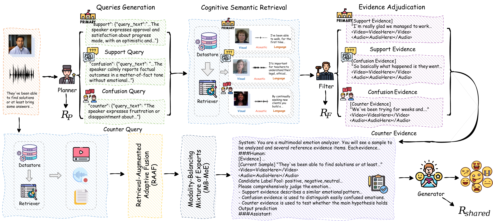

<h1 align="center"> AffectAgent</h1>

<h3 align="center">Collaborative Multi-Agent Reasoning for Retrieval-Augmented Multimodal Emotion Recognition</h3>

<p align="center"><strong>Official implementation of the ACM Multimedia 2026 paper</strong></p>

<p align="center">
  <a href="https://arxiv.org/abs/2604.12735"></a>
  <a href="https://doi.org/10.1145/3767308.3835848"></a>
  
  
  <a href="LICENSE"></a>
</p>

<p align="center">
  <a href="assets/affectagent-framework.png">
    
  </a>
</p>

AffectAgent replaces one-shot emotion prediction with three cooperating agents that share one
multimodal LLM (AffectGPT): a **Query Planner** writes support / confusion / counter retrieval
queries, an **Evidence Filter** accepts or rejects every retrieved item, and an **Emotion
Generator** predicts open-vocabulary emotions and a rationale from the kept evidence and an
audiovisual representation enhanced by **RAAF** and **MB-MoE**. The agents are warm-started by
role-specific SFT and optimised jointly with **MAPPO** using a shared affective reward.

## Paper-to-code map

| Paper | Code |
| --- | --- |
| Query Planner, observes x_t, x_v, x_a and C (Sec. 3.1-3.2) | `prompts.build_query_planner_messages`, `AffectAgentPipeline.run_query_planner` |
| Dual-channel Retriever, E_cog and E_perc | `retriever_service.DualChannelRetriever.retrieve_channel_A` / `retrieve_channel_B_candidates` |
| Evidence Filter, one Yes/No decision per candidate, a_F = [a_F^1 … a_F^K] | `prompts.parse_evidence_filter_output`, `AffectAgentPipeline.run_evidence_filter` |
| Emotion Generator, conditions on x_t, E*_cog, z_fuse and C | `prompts.build_emotion_generator_messages`, `AffectAgentPipeline.run_emotion_generator` |
| RAAF, equations (5)-(6) | `fusion_modules.RAAF` |
| MB-MoE, equation (7) | `fusion_modules.MBMoE` |
| Scores and rewards, equations (1)-(4) | `reward.AffectiveRewardComputer`, `labels.label_f1` |
| Score_label / Score_rank counterfactuals | `AffectAgentPipeline._run_reward_counterfactuals` |
| Terminal KL reward (10), GAE (9), clipped Actor / Critic losses (8), (11)-(12) | `mappo.PolicyGradientUpdater` |
| Role-specific SFT warm start | `build_sft_data.py`, `train_sft.py` |
| MER-UniBench metrics HIT / WAF / F_s | `unibench.py` |
| Missing-modality supplementation (Sec. 4.3) | `AffectAgentPipeline.prepare_inputs` |

## Installation

```bash
conda create -n affectagent python=3.10 -y
conda activate affectagent
pip install torch==2.4.0 torchvision==0.19.0 torchaudio==2.4.0 --index-url https://download.pytorch.org/whl/cu121
pip install -r requirements.txt
pip install vllm   # only needed to score the sentiment datasets (WAF)
```

Set `AFFECTAGENT_MODEL_ROOT` and `AFFECTAGENT_DATA_ROOT` (see `config.py`) to the folders that hold
the pretrained models (Qwen2.5-7B-Instruct, CLIP ViT-L/14, chinese-hubert-large, bert-base-uncased,
multilingual-e5-base) and the MER-UniBench / MER2025 data. `emotion_wheel/` is AffectGPT's emotion
wheel; it is required for the reward and for the metrics.

## Pipeline

All commands run from the repository root. Multi-GPU runs use `torchrun`; single-GPU runs use
`python -m ... --gpu 0`.

**1. Retrieval library (MER-Caption+ training set).** The audiovisual token store must be built
with the same AffectGPT checkpoint that SFT starts from; the audiovisual encoders stay frozen
afterwards, so it remains valid.

```bash
python -m affectagent.build_semantic_index --output-dir affectagent/artifacts/semantic_index
python -m retrieval.faiss.build_mercaptionplus_faiss --cfg-path configs/affectagent.yaml \
    --options model.ckpt_3=/path/to/affectgpt_mercaptionplus.pth \
    --output-root retrieval/faiss/artifacts/mercaptionplus
```

**2. Role-specific SFT data.** Built from the MER-Caption+ training split (the retrieval library).
Planner targets come from an OpenAI-compatible teacher (`OPENAI_API_KEY`, optional
`OPENAI_BASE_URL`); Filter and Generator targets are derived from the annotations.

```bash
python -m affectagent.build_sft_data --output affectagent/artifacts/sft_data/sft.jsonl --retrieval-top-k 3
```

**3. Role-specific SFT** (LoRA of the LLM, plus RAAF / MB-MoE through the Generator loss).

```bash
torchrun --nproc_per_node 2 -m affectagent.train_sft --cfg-path configs/affectagent.yaml \
    --options model.ckpt_3=/path/to/affectgpt_mercaptionplus.pth \
    --sft-data affectagent/artifacts/sft_data/sft.jsonl --output-dir output/affectagent_sft
```

**4. MAPPO.** The SFT adapters are merged and a new RL adapter is trained; π_SFT is the same
network with that adapter disabled, so no second LLM copy is kept in memory.

```bash
torchrun --nproc_per_node 2 -m affectagent.train_ppo --cfg-path configs/affectagent.yaml \
    --options model.ckpt_3=output/affectagent_sft/final/sft_checkpoint.pth \
    --sft-dir output/affectagent_sft/final --output-dir output/affectagent_mappo --gradient-checkpointing
```

`training_log.jsonl` reports, averaged over all ranks: Score_full / label / rank, agent rewards,
parse rates, kept evidence, policy / value loss, KL and clip fraction.

**5. Evaluation on MER-UniBench.**

```bash
torchrun --nproc_per_node 2 -m affectagent.evaluate --cfg-path configs/affectagent.yaml \
    --options model.ckpt_3=output/affectagent_sft/final/sft_checkpoint.pth \
    --ckpt-dir output/affectagent_mappo/final \
    --datasets mer2023 mer2024 meld iemocap cmumosi cmumosei sims simsv2 ovmerdplus \
    --variant full --output-dir output/eval/full
# WAF for the sentiment datasets (loads Qwen2.5 with vLLM after the GPUs are free):
python -m affectagent.unibench --predictions "output/eval/full/*/predictions.jsonl"
```

HIT and F_s are written to `metrics.json` directly. Decoding is greedy unless `--sample` is set.

## Ablations and robustness settings

| Paper setting | `affectagent.evaluate` option |
| --- | --- |
| Full AffectAgent | `--variant full` |
| w/o Planner (queries replaced by simple labels, as Score_label) | `--variant no_planner` |
| w/o Filter (Top-K items passed directly, as Score_rank) | `--variant no_filter` |
| w/o Planner and Filter (naive retrieval) | `--variant naive_rag` |
| SFT without retrieval | `--variant no_retrieval` with an SFT `--ckpt-dir` |
| w/o counter evidence / w/o confusion and counter evidence | `--variant no_counter` / `--variant support_only` |
| w/o RAAF / w/o MB-MoE | `--variant no_raaf` / `--variant no_mb_moe` |
| Missing text / video / audio (A+V, A+T, V+T) | `--missing-modalities text`, `video` or `audio` |

`predictions.jsonl` also records RAAF gate means and MB-MoE routing weights for the visualisation
experiments. Only the AffectGPT backbone is included in this release.

## Checkpoints

| Directory | Files |
| --- | --- |
| SFT (`train_sft`) | `sft_checkpoint.pth` (AffectGPT format, use as `model.ckpt_3`), `raaf.pth`, `mb_moe.pth`, `sft_config.json` |
| MAPPO (`train_ppo`) | `actor_adapter.pth`, `raaf.pth`, `mb_moe.pth`, `critic.pth`, `checkpoint_manifest.json` |

## Tests

```bash
python -m unittest discover -s tests -t . -v
```

The tests run on CPU with a toy language model. They cover the parsers, equations (1)-(4), the
counterfactual predictions, the identity initialisation and gradient flow of RAAF / MB-MoE, the
missing-modality path, GAE, the adapter-disabled reference policy and a complete MAPPO update.
They do not reproduce the paper's numbers.

## Citation

```bibtex
@inproceedings{10.1145/3767308.3835848,
  author    = {Wang, Zeheng and Yu, Zitong and Zhu, Yijie and Zhao, Bo and Liang, Haochen and Wang, Taorui and Xia, Wei and Zhang, Jiayu and Liu, Zhishu and Hui, Ma and Ma, Fei and Tian, Qi},
  title     = {AffectAgent: Collaborative Multi-Agent Reasoning for Retrieval-Augmented Multimodal Emotion Recognition},
  year      = {2026},
  isbn      = {9798400722134},
  publisher = {Association for Computing Machinery},
  address   = {New York, NY, USA},
  url       = {https://doi.org/10.1145/3767308.3835848},
  doi       = {10.1145/3767308.3835848},
  booktitle = {Proceedings of the 34th ACM International Conference on Multimedia},
  pages     = {11143--11152},
  numpages  = {10},
  keywords  = {multimodal emotion recognition, multi-agent reasoning, retrieval-augmented generation, multi-agent reinforcement learning},
  location  = {Rio de Janeiro, Brazil},
  series    = {MM '26}
}
```

## License

Released under the [Apache License 2.0](LICENSE). `my_affectgpt/`, `toolkit/` and `emotion_wheel/`
are adapted from [AffectGPT](https://github.com/zeroQiaoba/AffectGPT) (Apache-2.0).
